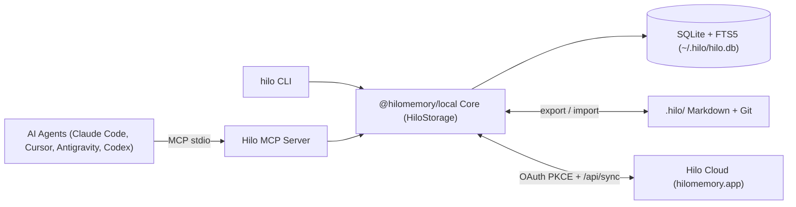

<div align="center">

# Hilo Local

**Local-first persistent memory, reusable skills, and technical docs for AI coding agents.**

[](./LICENSE)
[](https://nodejs.org/)
[](https://modelcontextprotocol.io/)
[](https://www.sqlite.org/fts5.html)

[Quickstart](#quickstart) · [Features](#features) · [Architecture](#architecture) · [MCP Setup](#mcp-setup) · [CLI Reference](#cli-reference) · [Hilo Cloud](#hilo-cloud)

</div>

---

AI coding agents start every session with amnesia. **Hilo Local** gives **Claude Code, Cursor, Antigravity, Codex, and OpenCode** a fast, structured, local-first brain powered by **SQLite + FTS5** and the **Model Context Protocol (MCP)**.

No account required. No external native build tools. Works 100% offline — with optional **Git sync** and one-command **OAuth cloud sync** to [hilomemory.app](https://hilomemory.app).

---

## Why Hilo Local?

| Capability | Hilo Local (MIT) | Basic Local Memory Tools | Hilo Cloud |
| :--- | :---: | :---: | :---: |
| **Typed memories** (`user`, `feedback`, `project`, `reference`) | ✅ | Observations only | ✅ |
| **Session context loader** (`contexto_cargar`) | ✅ | ✅ | ✅ |
| **Reusable AI Skills** (`skill_*`) | ✅ | ❌ | ✅ |
| **Indexed technical docs** (`doc_*`) | ✅ | ❌ | ✅ |
| **Isolated local profiles** (`perfil_*`) | ✅ | ❌ | ✅ |
| **Decision & event history** (`historial_*`) | ✅ | ❌ | ✅ |
| **Git-friendly Markdown sync** | ✅ | ✅ | ✅ |
| **SQLite observation importer** | ✅ | — | ✅ |
| **Remote OAuth MCP (web & mobile)** | — | — | ✅ |
| **Tapiz, Calendar, Boards, Team Sync** | — | — | ✅ |

---

## Features

- **Zero-dependency SQLite + FTS5**: Uses Node.js built-in `node:sqlite` (`DatabaseSync`) with automatic FTS5 full-text search triggers. No C++ compilation, Python, or Docker needed.
- **Structured Memory Taxonomy**: Separates durable `user` and `feedback` rules (always loaded in full) from `project` and `reference` memories (indexed by `tema` and fetched on demand).
- **Cross-Agent Skills**: Store and share reusable `SKILL.md` workflows across all your local AI tools.
- **Strict Profile Isolation**: Switch between `default`, `work`, or client-specific profiles so contexts never leak across projects.
- **Git-First Portability**: Export and import your entire profile as clean Markdown files with YAML frontmatter in `.hilo/`.
- **SQLite Observation Importer**: Migrate existing observations from third-party local SQLite memory databases.
- **Optional Cloud Sync (OAuth 2.0 PKCE)**: Connect to [hilomemory.app](https://hilomemory.app) anytime with `hilo cloud login` to sync between your terminal, web, and mobile.

---

## Architecture

Hilo Local is built around a storage-agnostic core (`HiloStorage`) so the exact same memory rules, context formatting, and MCP tool contracts work across both local SQLite and Hilo Cloud.



---

## Quickstart

### 1. Install

Requires **Node.js >= 22.5** (built-in `node:sqlite` support).

```bash
npm install -g @hilomemory/local
```

Or build from source:

```bash
git clone https://github.com/semillabiz/hilo-local.git
cd hilo-local
npm install
npm run build
npm link
```

### 2. Save your first memory

```bash
hilo save code-style \
  --type feedback \
  --summary "Always write concise TypeScript without external runtime deps" \
  --content "Prefer Node built-ins (node:sqlite, node:test) and strict types."
```

### 3. Connect your AI agent via MCP

---

## MCP Setup

Add **Hilo Local** to your agent's MCP configuration:

<details open>
<summary><strong>Claude Code</strong></summary>

```bash
claude mcp add hilo-local -- hilo mcp
```

</details>

<details>
<summary><strong>Cursor / Antigravity / Windsurf (<code>mcp.json</code>)</strong></summary>

```json
{
  "mcpServers": {
    "hilo-local": {
      "command": "hilo",
      "args": ["mcp"]
    }
  }
}
```

</details>

### Exposed MCP Tools

| Group | Tools |
| :--- | :--- |
| **Context** | `contexto_cargar` |
| **Memories** | `memoria_buscar`, `memoria_obtener`, `memoria_listar`, `memoria_guardar`, `memoria_borrar` |
| **Skills** | `skill_listar`, `skill_obtener`, `skill_guardar`, `skill_borrar` |
| **Docs** | `doc_buscar`, `doc_listar`, `doc_obtener`, `doc_guardar`, `doc_borrar` |
| **History** | `historial_buscar`, `historial_registrar` |
| **Profiles** | `perfil_listar`, `perfil_cambiar` |
| **Cloud Sync** | `nube_sincronizar` |

---

## CLI Reference

### Memories & Context

```bash
# Print the full context bundle for the active profile (optionally filtered by tema)
hilo context --tema backend

# Save or update a memory
hilo save db-choice --type project --tema backend \
  --summary "Use SQLite FTS5 for local search" \
  --content "Chosen for zero-config offline full-text ranking."

# Full-text search (FTS5)
hilo search "SQLite"

# Read a full memory
hilo get db-choice
```

### Isolated Profiles

```bash
hilo profile list
hilo profile use work --name "Work"
```

### Git Sync & SQLite Migration

```bash
# Export active profile to .hilo/ (Markdown + frontmatter)
hilo export

# Import from .hilo/ into SQLite (idempotent)
hilo import

# Import observations from an existing SQLite observations DB
hilo import-engram /path/to/observations.db
```

### Cloud Sync (Optional)

```bash
# Authenticate via browser using OAuth 2.0 PKCE
hilo cloud login

# Headless / remote terminal login
hilo cloud login --manual

# Or with a static API token
hilo cloud login --token <your-token>

# Sync bidirectionally (pull + push)
hilo cloud sync

# Check status or log out
hilo cloud status
hilo cloud logout
```

---

## Environment Variables

| Variable | Default | Description |
| :--- | :--- | :--- |
| `HILO_DB_PATH` | `~/.hilo/hilo.db` | Custom SQLite database path |
| `HILO_PROFILE` | Active DB profile (`default`) | Override active profile ID |
| `HILO_CLOUD_CONFIG_PATH` | `~/.hilo/cloud.json` | Custom cloud credentials path |
| `HILO_CLOUD_ORIGIN` | `https://hilomemory.app` | Custom Hilo Cloud server origin |
| `HILO_CLOUD_TOKEN` | — | Static Bearer token override |

---

## Hilo Cloud

**Hilo Local** is 100% free and open source under MIT. When you need your context outside the terminal, connect it to **[hilomemory.app](https://hilomemory.app)**:

- **Remote OAuth MCP**: Access your memories and skills from Claude web, mobile apps, and cloud agents without keeping your laptop online.
- **Visual Workspace**: **Tapiz** (block pages & databases), **Calendar**, **Boards**, **Sheets**, **Forms**, **Projects**, and the **3D Profile Constellation**.
- **Managed Connectors & Team Sync**: Native integrations with GitHub, Notion, Google Calendar, and Semilla ERP, plus real-time multi-user permissions without Git merge conflicts.

---

## Development & Tests

```bash
npm install
npm test
```

Tests run against `node:test` and cover SQLite + FTS5 search, profile isolation, Git Markdown roundtrips, SQLite observation migration, `/api/sync` push/pull, and OAuth 2.0 PKCE + `refresh_token` renewal.

---

## License

[MIT](./LICENSE) © 2026 Hilo Memory
